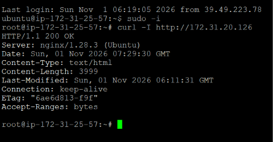
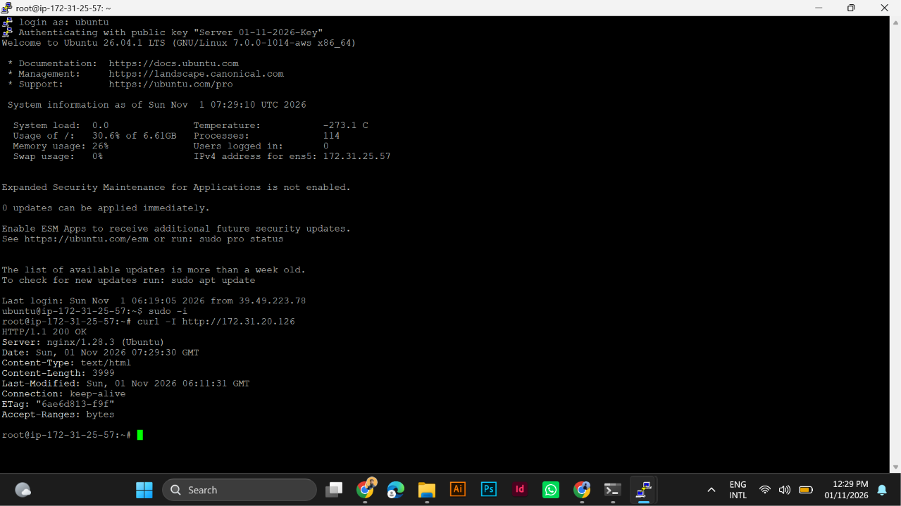
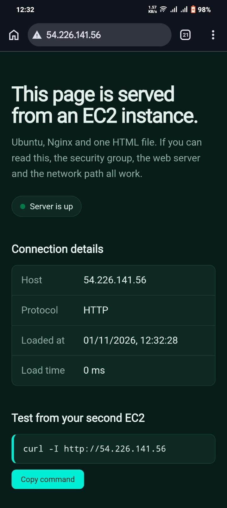
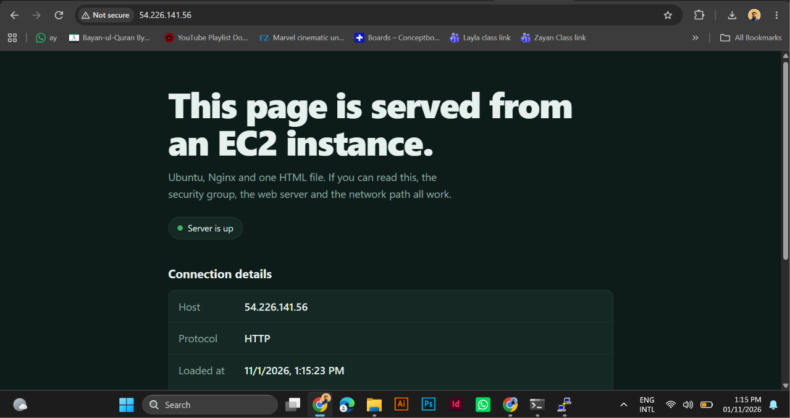

# Static Website on AWS EC2 (Nginx)

Static website hosted on an Ubuntu EC2 instance and accessed from a second EC2 instance.

## Architecture
- EC2 #1: Ubuntu + Nginx (web server)
- EC2 #2: Ubuntu (client, tests with curl)
- Security group: HTTP (80) open, SSH (22) My IP only

## Setup
1. Launch two Ubuntu EC2 instances in the same VPC
2. Connect with PuTTY (.pem converted to .ppk)
3. On server: sudo apt update && sudo apt install nginx -y
4. Copy index.html to /var/www/html/
5. From client: curl -I http://SERVER_PRIVATE_IP

## Screenshots

